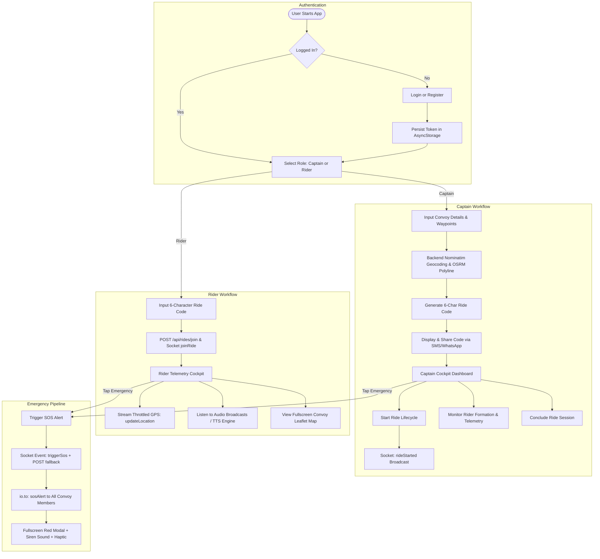
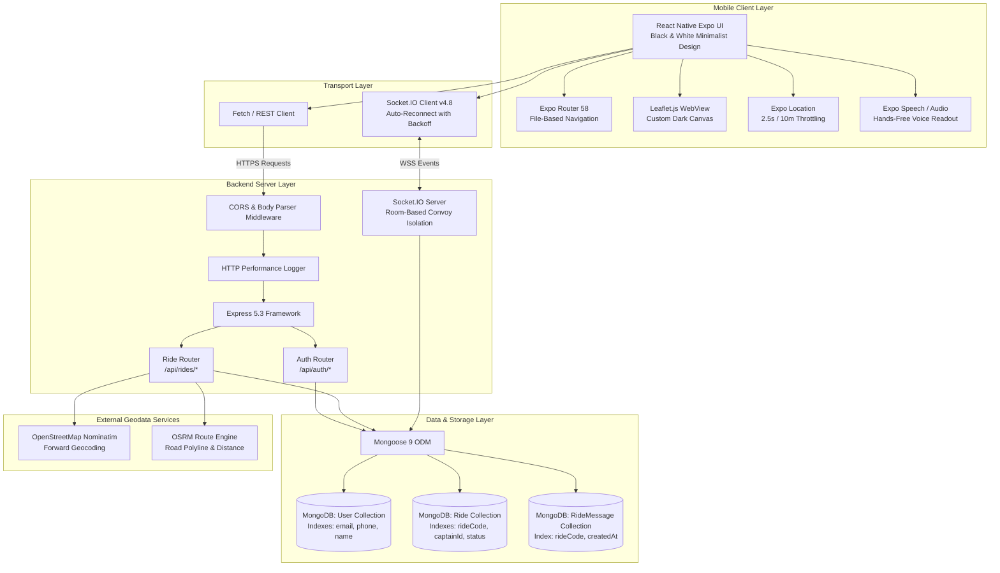
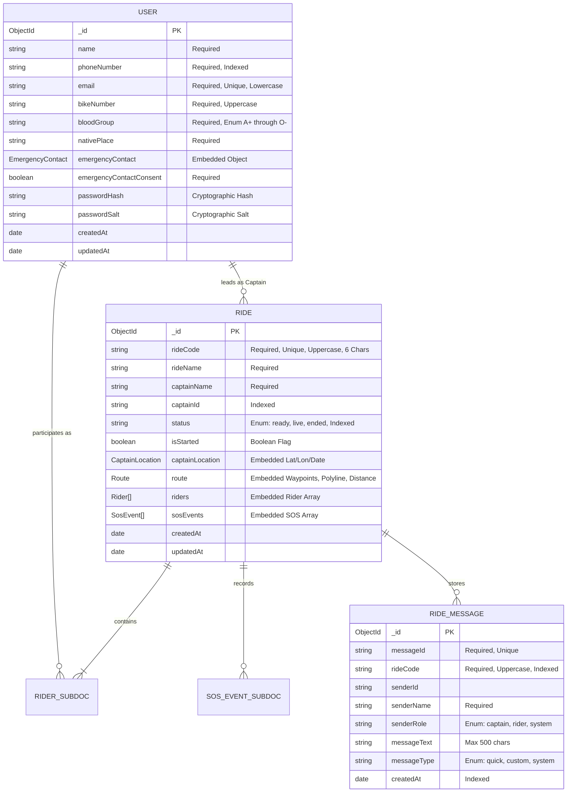

# RYDO

**The Connected Motorcycle Convoy and Real-Time Group Riding Platform**

[](https://expo.dev)
[](https://reactnative.dev)
[](https://react.dev)
[](https://www.typescriptlang.org)
[](https://nodejs.org)
[](https://expressjs.com)
[](https://www.mongodb.com)
[](https://socket.io)

---

## Table of Contents

- [1. Executive Overview](#1-executive-overview)
- [2. Problem Statement](#2-problem-statement)
- [3. Product Features](#3-product-features)
  - [3.1 Authentication & User Profiles](#31-authentication--user-profiles)
  - [3.2 Role-Based Convoy Management](#32-role-based-convoy-management)
  - [3.3 Convoy Creation & Code Generation](#33-convoy-creation--code-generation)
  - [3.4 Joining Rides via Passkey](#34-joining-rides-via-passkey)
  - [3.5 Real-Time Location Synchronization](#35-real-time-location-synchronization)
  - [3.6 In-Ride Voice & Communication Engine](#36-in-ride-voice--communication-engine)
  - [3.7 Navigation & Interactive Mapping](#37-navigation--interactive-mapping)
  - [3.8 SOS Emergency Response System](#38-sos-emergency-response-system)
  - [3.9 Group Music Integration Status](#39-group-music-integration-status)
  - [3.10 WebSocket Real-Time Infrastructure](#310-websocket-real-time-infrastructure)
- [4. User Workflows](#4-user-workflows)
- [5. Technology Stack](#5-technology-stack)
- [6. System Architecture](#6-system-architecture)
- [7. Repository Structure](#7-repository-structure)
- [8. Database Architecture](#8-database-architecture)
- [9. REST API Documentation](#9-rest-api-documentation)
- [10. Socket.IO Event Specification](#10-socketio-event-specification)
- [11. Installation & Local Setup](#11-installation--local-setup)
- [12. Environment Variables](#12-environment-variables)
- [13. Running the Application](#13-running-the-application)
- [14. Testing & Quality Assurance](#14-testing--quality-assurance)
- [15. Security Architecture](#15-security-architecture)
- [16. Performance & Scalability](#16-performance--scalability)
- [17. Production Deployment](#17-production-deployment)
- [18. Troubleshooting](#18-troubleshooting)
- [19. Current Development Status](#19-current-development-status)
- [20. Product Roadmap](#20-product-roadmap)
- [21. Contributing](#21-contributing)
- [22. License](#22-license)
- [23. Acknowledgements & Repository Info](#23-acknowledgements--repository-info)

---

## 1. Executive Overview

**RYDO** is an engineered mobile-first motorcycle convoy coordination and rider telemetry platform. Designed specifically for group motorcycling tours, riding clubs, and convoy operations, RYDO unifies multi-vehicle GPS telemetry, convoy lifecycle management, hands-free synthesized voice messaging, and real-time emergency SOS broadcast channels into a single, distraction-minimized mobile interface.

In group riding, situational awareness is directly linked to rider safety. Conventional group rides rely on fragmented toolchains—consumer messaging apps, generic GPS navigation, and visual hand gestures—that break down at highway speeds, across traffic lights, or in poor visibility. RYDO addresses this operational deficit by establishing a persistent, event-driven mesh between a designated convoy leader (the **Captain**) and participating group members (**Riders**).

### Core Operating Paradigm
- **Captain Leadership:** A designated convoy lead creates the ride session, defines the route waypoints, monitors formation telemetry, and controls the ride lifecycle (Ready, Live, Concluded).
- **Unique Ride Code Generation:** The backend issues a 6-character cryptographic passkey (excluding ambiguous alphanumeric characters) that permits group riders to discover and bind to the convoy room.
- **Bi-Directional Telemetry:** Riders stream low-latency GPS coordinates that are aggregated into convoy-isolated rooms and rendered on a unified, high-contrast dark map canvas.
- **Emergency Resilience:** Any participant can trigger a high-priority SOS alert that cuts through UI states, activates local sirens, highlights rider location and emergency medical data, and broadcasts to all convoy members within milliseconds.

---

## 2. Problem Statement

Group motorcycle touring presents unique physical and logistical challenges that standard mobile mapping and chat software fail to solve:

| Challenge | Real-World Impact | How RYDO Solves It |
|:---|:---|:---|
| **Convoy Fragmentation** | Riders get separated at highway merges, toll gates, and city traffic signals, resulting in riders taking wrong turns or getting lost. | Unified convoy dashboard tracks distance between each rider and the captain with real-time distance delta and last-seen indicators. |
| **Dangerous Distracted Riding** | Typing on a smartphone while operating a motorcycle with gloves is lethal; checking text notifications demands looking away from the road. | Automated Text-to-Speech (TTS) engine reads incoming captain alerts hands-free over Bluetooth helmet headsets. |
| **Uncoordinated Navigation** | Each rider using their own GPS app results in divergent routing choices, missed regrouping stops, and convoy disbandment. | Centralized route model generated by OpenStreetMap / OSRM coordinates ensures all riders follow identical convoy waypoints and turn coordinates. |
| **Emergency Delays** | In an accident, a downed rider may be stranded out of sight around blind corners with zero immediate awareness from the group ahead. | One-touch SOS event broadcast transmits real-time GPS coordinates, vehicle registration number, blood group, and emergency contact details across the convoy immediately. |
| **Battery & Telemetry Drain** | High-frequency GPS updates drain smartphone batteries rapidly during long 8-to-12-hour cross-country rides. | Dynamic location throttling transmits coordinates on 2.5-second minimum intervals or 10-meter spatial displacements, cutting background power consumption. |

---

## 3. Product Features

### 3.1 Authentication & User Profiles
- **Implementation Status:** `Implemented` (Verified in automated test suite).
- **Workflow:** Riders register with full name, unique mobile phone number, unique email address, motorcycle registration plate (`bikeNumber`), blood group (`enum: A+, A-, B+, B-, AB+, AB-, O+, O-`), hometown (`nativePlace`), and emergency contact details with explicit legal consent.
- **Frontend:** Implemented in [`mobile/app/register.tsx`](file:///e:/Rydo/mobile/app/register.tsx) and [`mobile/app/login.tsx`](file:///e:/Rydo/mobile/app/login.tsx) with persistent token storage via `@react-native-async-storage/async-storage`.
- **Backend:** Handled by [`backend/routes/authRoutes.js`](file:///e:/Rydo/backend/routes/authRoutes.js) and [`backend/models/User.js`](file:///e:/Rydo/backend/models/User.js). Passwords are cryptographically salted and hashed. Safe user projection (`toSafeObject()`) automatically strips password hashes and salts, masking emergency phone numbers where appropriate.

### 3.2 Role-Based Convoy Management
- **Implementation Status:** `Implemented`.
- **Captain Role:** Holds sole authority to start the ride (`PATCH /api/rides/:rideCode/status`), modify route waypoints, remove disruptive riders, and formally end the convoy.
- **Rider Role:** Joins an existing convoy session, streams GPS telemetry, receives live routing polyline updates, listens to hands-free broadcasts, and triggers SOS alerts.
- **Screen Implementations:** Dedicated high-contrast cockpits in [`mobile/app/captain-dashboard.tsx`](file:///e:/Rydo/mobile/app/captain-dashboard.tsx) and [`mobile/app/rider-dashboard.tsx`](file:///e:/Rydo/mobile/app/rider-dashboard.tsx).

### 3.3 Convoy Creation & Code Generation
- **Implementation Status:** `Implemented`.
- **Workflow:** Captain inputs convoy name, origin, destination, and optional waypoints in [`mobile/app/create-ride.tsx`](file:///e:/Rydo/mobile/app/create-ride.tsx).
- **Backend Mechanics:** `POST /api/rides` verifies payload, performs forward geocoding via OpenStreetMap Nominatim, calculates initial road distances, generates a collision-resistant 6-character code (using alphabet `ABCDEFGHJKLMNPQRSTUVWXYZ23456789`), and seeds the MongoDB document with status `ready`.
- **Presentation:** [`mobile/app/ride-created.tsx`](file:///e:/Rydo/mobile/app/ride-created.tsx) presents the 6-character passkey with native clipboard copy and WhatsApp/SMS share sheet integration.

### 3.4 Joining Rides via Passkey
- **Implementation Status:** `Implemented`.
- **Workflow:** Participant navigates to [`mobile/app/join-ride.tsx`](file:///e:/Rydo/mobile/app/join-ride.tsx) and inputs the 6-character ride code.
- **Validation:** Frontend normalizes input to uppercase; `POST /api/rides/join` verifies ride existence, checks if the convoy is already ended, registers the rider in the `riders` subdocument array, and establishes real-time room membership via Socket.IO.

### 3.5 Real-Time Location Synchronization
- **Implementation Status:** `Implemented`.
- **Hardware Integration:** Driven by `expo-location` with high-accuracy GPS tracking.
- **Throttling Pipeline:** GPS updates are filtered by a 2.5-second time window or 10-meter displacement threshold before transmitting via WebSocket event `updateLocation`.
- **Fallback HTTP API:** If socket connectivity encounters intermittent transport degradation, updates fail over to `POST /api/rides/:rideCode/location`.
- **Convoy Snapshot:** New or reconnected participants receive instantaneous snapshot state (`requestLocationSnapshot` -> `locationsSnapshot`) containing the latest coordinates of all active convoy members.

### 3.6 In-Ride Voice & Communication Engine
- **Implementation Status:** `Partially Implemented` (Text-to-Speech & Pre-Set Alerts Implemented; WebRTC Voice Mesh In Development).
- **Current Capability:** Located in [`mobile/services/ttsService.ts`](file:///e:/Rydo/mobile/services/ttsService.ts) and [`mobile/app/communication.tsx`](file:///e:/Rydo/mobile/app/communication.tsx). Incoming quick messages ("Regroup at next fuel station", "Stop immediately", "Hazard on right shoulder") are synthesized into spoken audio using platform TTS (`expo-speech` on native and `window.speechSynthesis` on web) to allow hands-free helmet audio reception.
- **Planned VoIP Capability:** Full-duplex peer-to-peer audio mesh over WebRTC is under active development.

### 3.7 Navigation & Interactive Mapping
- **Implementation Status:** `Implemented`.
- **Map Provider:** Custom Leaflet.js runtime hosted inside a performant `react-native-webview` component ([`mobile/components/RydoMap.tsx`](file:///e:/Rydo/mobile/components/RydoMap.tsx) and [`mobile/app/live-ride-map.tsx`](file:///e:/Rydo/mobile/app/live-ride-map.tsx)).
- **Aesthetic:** High-contrast Swiss Apple dark tiles styled via CartoDB Dark Matter / OpenStreetMap tiles.
- **Telemetry Visuals:** Differentiates Captain (gold star marker with pulsed halo), active riders (white radar pings), inactive riders (grey dimmed markers), and SOS alerts (flashing red beacon).
- **Polyline Routing:** Decodes and renders OSRM route geometry from start point through sequenced waypoints to final destination.

### 3.8 SOS Emergency Response System
- **Implementation Status:** `Implemented`.
- **Workflow:** Accessible via persistent floating SOS trigger across all ride dashboards and live map screens.
- **Event Mechanics:** Dispatches socket event `triggerSos` and redundant HTTP fallback `POST /api/rides/:rideCode/sos`.
- **Emergency Envelope:** Transmits rider name, GPS coordinates, motorcycle plate number, blood group, and emergency contact details.
- **Client Handling:** Displays full-screen red emergency modal overlay, plays looped siren audio alert via `expo-audio`, triggers heavy haptic vibration pulses, and pans the Leaflet map directly to the distressed rider's coordinates.

### 3.9 Group Music Integration Status
- **Implementation Status:** `Planned` (Not yet integrated).
- **Clarification:** While group playlist synchronization (Spotify / Apple Music Group Sessions) is a roadmap objective for social touring, there is currently no active media player or third-party streaming SDK integration in the repository.

### 3.10 WebSocket Real-Time Infrastructure
- **Implementation Status:** `Implemented`.
- **Engine:** Socket.IO v4.8 server mounted directly on the Express HTTP instance in [`backend/server.js`](file:///e:/Rydo/backend/server.js) with modular socket routing in [`backend/socket/rideSocket.js`](file:///e:/Rydo/backend/socket/rideSocket.js).
- **Room Isolation:** Clients join a room partitioned strictly by `rideCode`. Location updates, chat broadcasts, and emergency alerts are broadcast strictly within room boundaries (`io.to(rideCode).emit(...)`), preventing cross-convoy data leaks.

---

## 4. User Workflows



---

## 5. Technology Stack

### Mobile Frontend

| Technology | Version | Purpose in RYDO |
|:---|:---:|:---|
| **Expo SDK** | `58.0.23` | Application framework, build tooling, and native runtime abstractions. |
| **React Native** | `0.88.1` | Native mobile rendering engine for Android and iOS platforms. |
| **React / React-DOM** | `19.3.0` | Declarative UI component state model and hook lifecycle. |
| **TypeScript** | `~6.0.3` | Static type safety across all screens, components, services, and models. |
| **Expo Router** | `~58.0.30` | File-system-based routing with native transitions, tabs, and modals. |
| **React Native WebView** | `14.0.1` | Embedded browser canvas hosting the Leaflet OpenStreetMap dark map. |
| **Expo Location** | `~58.0.20` | Native hardware GPS tracking with high-accuracy coordinates. |
| **Expo Speech** | `~58.0.3` | Text-to-Speech synthesis for hands-free captain voice broadcasts. |
| **Expo Audio** | `~58.0.11` | Siren sound player and audio alert playback for emergency events. |
| **Expo Haptics** | `~58.0.7` | Hardware tactile feedback for UI taps, SOS triggers, and warning states. |
| **Socket.IO Client** | `^4.8.1` | Persistent WebSocket connection client with exponential backoff reconnect. |
| **AsyncStorage** | `2.2.0` | Local persistent storage for auth tokens, cached rides, and settings. |

### Backend API & Real-Time Engine

| Technology | Version | Purpose in RYDO |
|:---|:---:|:---|
| **Node.js** | `v20.x` / `v22.x` | High-throughput asynchronous JavaScript runtime environment. |
| **Express.js** | `^5.2.1` | Core REST API web framework, routing, and HTTP middleware. |
| **Socket.IO** | `^4.8.3` | Low-latency bi-directional WebSocket engine with room partitioning. |
| **Mongoose** | `^9.9.2` | Object Document Mapper (ODM) for MongoDB schema modeling and indexes. |
| **MongoDB Driver** | `^7.5.0` | Official high-performance native MongoDB database connection driver. |
| **CORS** | `^2.8.6` | Cross-Origin Resource Sharing middleware enabling flexible client access. |
| **Dotenv** | `^17.4.2` | Zero-dependency environment variable configuration loader. |

### Infrastructure & External Services

| Service / Tool | Purpose |
|:---|:---|
| **MongoDB Atlas** | Cloud database cluster hosting persistent user and ride collections. |
| **OpenStreetMap Nominatim** | Forward geocoding translating location names into latitude/longitude pairs. |
| **OSRM (Routing Engine)** | Road geometry routing engine generating coordinates and distance metrics. |
| **CartoDB Dark Matter** | Minimalist dark-mode map tiles tailored to the Swiss design aesthetic. |
| **Render.com** | Node.js web service PaaS hosting the backend REST and WebSocket server. |
| **Expo EAS Build** | Cloud build infrastructure compiling standalone Android APK/AAB packages. |

---

## 6. System Architecture



---

## 7. Repository Structure

```
RYDO/
├── .github/                         # GitHub Actions CI Workflows & Community Templates
│   ├── workflows/ci.yml             # Automated CI (Backend tests, Mobile Typecheck & Lint)
│   ├── ISSUE_TEMPLATE/              # Structured bug reports & feature requests
│   └── PULL_REQUEST_TEMPLATE.md     # Standardized pull request submission template
├── .env.example                     # Root configuration template
├── .gitattributes                   # Cross-platform line endings and binary attributes
├── .gitignore                       # Production gitignore (node_modules, build artifacts, envs)
├── CHANGELOG.md                     # Modernization changelog and migration notes
├── CONTRIBUTING.md                  # Guidelines for open-source contributions
├── README.md                        # Master project documentation (this document)
├── SECURITY.md                      # Security policy, vulnerability reporting & disclosure
├── package.json                     # Root project manifest
│
├── docs/                            # Modular Production Documentation
│   ├── architecture/
│   │   ├── ARCHITECTURE.md          # Comprehensive architectural blueprint
│   │   └── MOBILE_APP_DOCUMENTATION.md # Mobile screens and UI architecture
│   ├── api/
│   │   └── API_DOCUMENTATION.md     # Complete REST API & WebSocket specification
│   ├── database/
│   │   └── DATABASE_SCHEMA.md       # Detailed database schemas, types, and indexes
│   ├── security/
│   │   └── ENVIRONMENT_VARIABLES.md # Comprehensive env reference guide
│   ├── deployment/
│   │   └── DEPLOYMENT_GUIDE.md      # Cloud deployment and EAS build manual
│   └── development/
│       ├── SETUP_GUIDE.md           # Step-by-step local developer setup guide
│       ├── TEAM_SETUP.md            # Team development & workflow reference
│       ├── TESTING_GUIDE.md         # Test execution and verification manual
│       ├── DEVELOPMENT_STATUS.md    # Verified status of all features
│       ├── UPGRADE_REPORT.md        # Modernization audit and Expo 58 report
│       └── README_VALIDATION_REPORT.md # Documentation verification report
│
├── backend/                         # Node.js / Express / Socket.IO Backend
│   ├── .env.example                 # Backend environment variable template
│   ├── package.json                 # Backend dependencies (Express 5, Mongoose 9, Socket.IO 4)
│   ├── package-lock.json            # Deterministic backend dependency tree
│   ├── server.js                    # Server entry point, middleware, and connection handlers
│   ├── models/                      # Mongoose Schema Definitions
│   │   ├── User.js                  # User profile, emergency contacts, password hashing
│   │   ├── Ride.js                  # Ride document, waypoints, convoy participants, SOS events
│   │   └── RideMessage.js           # Chronological convoy communication messages
│   ├── routes/                      # REST API Endpoints
│   │   ├── authRoutes.js            # Registration, login, profile updates, password change
│   │   └── rideRoutes.js            # Ride lifecycle, geocoding, SOS, and messages
│   ├── socket/                      # WebSocket Event Handlers
│   │   └── rideSocket.js            # Real-time room management, location streaming, SOS delivery
│   └── tests/                       # Automated Test Suites
│       └── integration.test.js      # 13-step end-to-end backend integration tests
│
└── mobile/                          # React Native / Expo Mobile Client
    ├── .env.example                 # Mobile environment variable template
    ├── app.json                     # Expo application configuration & native permissions
    ├── eslint.config.js             # Modern ESLint flat configuration
    ├── package.json                 # Mobile dependencies (Expo 58, RN 0.88, React 19)
    ├── package-lock.json            # Deterministic mobile dependency tree
    ├── tsconfig.json                # TypeScript compiler configuration (strict mode)
    ├── app/                         # Expo Router File-Based Application Screens
    │   ├── _layout.tsx              # Root stack navigation layout & theme provider
    │   ├── index.tsx                # Splash & onboarding entrance
    │   ├── login.tsx                # Rider authentication login
    │   ├── register.tsx             # Rider account registration
    │   ├── ride-choice.tsx          # Role selection (Captain vs Rider)
    │   ├── create-ride.tsx          # Convoy creation & waypoint input form
    │   ├── ride-created.tsx         # Passkey display & share sheet
    │   ├── join-ride.tsx            # Convoy code entry screen
    │   ├── captain-dashboard.tsx    # Convoy leader telemetry cockpit & ride controls
    │   ├── rider-dashboard.tsx      # Convoy participant telemetry cockpit
    │   ├── live-ride-map.tsx        # Fullscreen interactive Leaflet map canvas
    │   ├── route-planner.tsx        # Waypoint builder & road distance calculator
    │   ├── communication.tsx        # In-convoy audio chat & TTS message history
    │   └── profile.tsx              # User profile & emergency contact editor
    ├── components/                  # Reusable UI & Map Components
    │   ├── RydoMap.tsx              # Performant Leaflet WebView bridge
    │   ├── MessagePopup.tsx         # Floating in-ride broadcast notifications
    │   ├── ErrorBoundary.tsx        # React component crash isolation wrapper
    │   └── OfflineNotice.tsx        # Network degradation banner
    └── services/                    # Hardware Bridges & Client Singletons
        ├── communicationService.ts  # In-ride message queue & audio player
        ├── communicationSettings.ts # User audio preferences & TTS configurations
        ├── socketService.ts         # Centralized Socket.IO client manager
        ├── sosService.ts            # SOS event dispatcher & siren controller
        └── ttsService.ts            # Platform-safe Text-to-Speech synthesis
```

---

## 8. Database Architecture

RYDO utilizes MongoDB with Mongoose schemas configured with production indexes, field validation, and strict sanitization.

### Entity Relationship Diagram



### Collection Schemas & Field Details

#### 1. `User` Collection (`backend/models/User.js`)
- **`email`**: `String`, required, unique, lowercase, trimmed.
- **`phoneNumber`**: `String`, required, trimmed, indexed.
- **`bloodGroup`**: `String`, required, uppercase, enum: `['A+', 'A-', 'B+', 'B-', 'AB+', 'AB-', 'O+', 'O-']`.
- **`emergencyContact`**: Subdocument containing `name` (`String`, required) and `phoneNumber` (`String`, required).
- **`passwordHash` / `passwordSalt`**: `String`, required, stripped during serialization via `toSafeObject()`.

#### 2. `Ride` Collection (`backend/models/Ride.js`)
- **`rideCode`**: `String`, required, unique, uppercase, 6 characters. Primary convoy partition key.
- **`status`**: `String`, enum: `['ready', 'live', 'ended']`, default: `'ready'`, indexed.
- **`isStarted`**: `Boolean`, default: `false`.
- **`captainLocation`**: Embedded `{ latitude: Number, longitude: Number, updatedAt: Date }`.
- **`route`**: Embedded object with `start`, `destination`, `stops` array, OSRM road `coordinates` array, `distanceMeters`, `distanceKm`, `durationSeconds`, and `durationMinutes`.
- **`riders`**: Array of subdocuments containing `userId`, `name`, `joinedAt`, and `location: { latitude, longitude, updatedAt }`.
- **`sosEvents`**: Array of emergency events containing `riderName`, `bikeNumber`, `bloodGroup`, `emergencyContact`, `status: 'active' | 'resolved'`, `latitude`, `longitude`, `triggeredAt`.

#### 3. `RideMessage` Collection (`backend/models/RideMessage.js`)
- **`messageId`**: `String`, required, unique.
- **`rideCode`**: `String`, required, uppercase, indexed.
- **`senderRole`**: `String`, enum: `['captain', 'rider', 'system']`.
- **`messageText`**: `String`, required, max length 500 characters.
- **Compound Index**: `{ rideCode: 1, createdAt: 1 }` for high-speed chronological history queries.

---

## 9. REST API Documentation

Base URL (Local): `http://localhost:5000`  
Base URL (Staging / Production): `https://rydo-irav.onrender.com`

All standard endpoints return responses formatted in consistent JSON envelopes:
```json
{
  "success": true,
  "data": {},
  "message": "Operation completed successfully"
}
```

### 9.1 Authentication & Profile Endpoints

#### `POST /api/auth/register`
- **Purpose:** Registers a new user account with emergency contact details.
- **Request Body:**
  ```json
  {
    "name": "Alex Rider",
    "phoneNumber": "9876543210",
    "email": "alex@example.com",
    "bikeNumber": "KA 01 AB 1234",
    "bloodGroup": "O+",
    "nativePlace": "Bangalore",
    "emergencyContactName": "Sarah Rider",
    "emergencyContactPhone": "9876543211",
    "emergencyContactConsent": true,
    "password": "SecurePassword123!",
    "confirmPassword": "SecurePassword123!"
  }
  ```
- **Success Response (201 Created):**
  ```json
  {
    "success": true,
    "message": "User registered successfully",
    "user": {
      "_id": "67cb1a2e84b369e8...",
      "name": "Alex Rider",
      "email": "alex@example.com",
      "bikeNumber": "KA 01 AB 1234",
      "bloodGroup": "O+",
      "emergencyContact": { "name": "Sarah Rider", "phoneNumber": "9876543211" }
    }
  }
  ```

#### `POST /api/auth/login`
- **Purpose:** Authenticates user credentials and returns safe user profile.
- **Request Body:**
  ```json
  {
    "email": "alex@example.com",
    "password": "SecurePassword123!"
  }
  ```
- **Success Response (200 OK):**
  ```json
  {
    "success": true,
    "message": "Login successful",
    "user": {
      "_id": "67cb1a2e84b369e8...",
      "name": "Alex Rider",
      "email": "alex@example.com",
      "bikeNumber": "KA 01 AB 1234"
    }
  }
  ```

#### `GET /api/auth/profile/:userId`
- **Purpose:** Retrieves sanitized profile by MongoDB Object ID.

#### `PATCH /api/auth/profile/:userId`
- **Purpose:** Updates profile attributes (bike plate, blood group, emergency contacts).

---

### 9.2 Ride Lifecycle & Convoy Endpoints

#### `POST /api/rides`
- **Purpose:** Creates a new convoy, performs Nominatim geocoding, and generates 6-character ride passkey.
- **Request Body:**
  ```json
  {
    "rideName": "Western Ghats Monsoon Tour",
    "captainName": "Alex Rider",
    "captainId": "user_12345",
    "startLocation": "Bangalore",
    "destinationLocation": "Coorg",
    "stops": ["Mysore"]
  }
  ```
- **Success Response (201 Created):**
  ```json
  {
    "success": true,
    "message": "Ride created successfully",
    "rideCode": "K8M2P9",
    "ride": {
      "rideCode": "K8M2P9",
      "rideName": "Western Ghats Monsoon Tour",
      "status": "ready",
      "isStarted": false,
      "route": {
        "start": { "name": "Bangalore", "latitude": 12.9716, "longitude": 77.5946 },
        "destination": { "name": "Coorg", "latitude": 12.3375, "longitude": 75.8069 }
      }
    }
  }
  ```

#### `GET /api/rides/:rideCode`
- **Purpose:** Retrieves complete convoy snapshot (captain location, riders, waypoints, SOS history).
- **Success Response (200 OK):**
  ```json
  {
    "success": true,
    "ride": {
      "rideCode": "K8M2P9",
      "rideName": "Western Ghats Monsoon Tour",
      "status": "live",
      "isStarted": true,
      "riders": []
    }
  }
  ```

#### `POST /api/rides/join`
- **Purpose:** Registers a participant into the convoy using the 6-character code.
- **Request Body:**
  ```json
  {
    "rideCode": "K8M2P9",
    "name": "Carlos Rider",
    "userId": "user_67890"
  }
  ```
- **Success Response (200 OK):** Returns `{ "success": true, "message": "Joined ride successfully", "ride": { ... } }`.

#### `PATCH /api/rides/:rideCode/status`
- **Purpose:** Toggles convoy between `ready`, `live`, and `ended` states.
- **Request Body:**
  ```json
  {
    "isStarted": true,
    "status": "live"
  }
  ```

#### `POST /api/rides/:rideCode/location`
- **Purpose:** HTTP fallback endpoint for telemetry synchronization.
- **Request Body:**
  ```json
  {
    "memberId": "user_67890",
    "name": "Carlos Rider",
    "role": "rider",
    "latitude": 12.9716,
    "longitude": 77.5946
  }
  ```

#### `POST /api/rides/:rideCode/sos`
- **Purpose:** Broadcasts emergency alert with rider telemetry and medical profile.
- **Request Body:**
  ```json
  {
    "riderName": "Carlos Rider",
    "name": "Carlos Rider",
    "role": "rider",
    "latitude": 12.9716,
    "longitude": 77.5946
  }
  ```
- **Success Response (200 OK):** Returns `{ "success": true, "message": "SOS broadcast recorded", "sos": { ... } }`.

#### `POST /api/rides/:rideCode/messages`
- **Purpose:** Persists in-ride message and triggers real-time broadcast.
- **Request Body:**
  ```json
  {
    "senderName": "Alex Rider",
    "senderRole": "captain",
    "messageText": "Regroup at fuel station in 5 km",
    "messageType": "quick"
  }
  ```

#### `GET /api/rides/:rideCode/messages`
- **Purpose:** Fetches chronological message history for convoy session.

#### `POST /api/rides/:rideCode/leave`
- **Purpose:** Gracefully removes a participant from the active convoy.

---

## 10. Socket.IO Event Specification

Socket connections establish room-isolated transport over WebSockets.

### Client-to-Server Events

| Event Name | Payload Shape | Description |
|:---|:---|:---|
| `joinRide` | `{ rideCode: string, name: string, userId?: string, role?: string }` | Joins the socket room partitioned by `rideCode`. |
| `updateLocation` | `{ rideCode: string, memberId: string, name: string, role: string, latitude: number, longitude: number }` | Emits current GPS coordinates for convoy aggregation. |
| `requestLocationSnapshot`| `{ rideCode: string }` | Solicits immediate snapshot of all known member coordinates. |
| `triggerSos` | `{ rideCode: string, name: string, role: string, latitude: number, longitude: number }` | Triggers emergency SOS alert across convoy members. |
| `ride:message:send` | `{ rideCode: string, senderName: string, senderRole: string, messageText: string, messageType: string }` | Sends an in-convoy text/preset message for audio synthesis. |
| `startRide` | `{ rideCode: string }` | Captain triggers start of live ride. |
| `endRide` | `{ rideCode: string }` | Captain concludes active ride session. |
| `leaveRide` | `{}` | Gracefully leaves convoy room. |

### Server-to-Client Events

| Event Name | Payload Shape | Description |
|:---|:---|:---|
| `rideJoined` | `{ success: true, rideCode: string, ride: object }` | Confirmation emitted to the connecting client. |
| `userJoined` | `{ memberId: string, name: string, role: string }` | Broadcast to existing room members on participant join. |
| `locationUpdated` | `{ memberId: string, name: string, role: string, latitude: number, longitude: number, updatedAt: string }` | Real-time GPS coordinate ping broadcast to room. |
| `locationsSnapshot` | `{ success: true, locations: object }` | Snapshot map of all active riders in convoy. |
| `sosAlert` | `{ sosId: string, riderName: string, latitude: number, longitude: number, bloodGroup: string, emergencyContact: object }` | High-priority emergency broadcast triggering modal & siren. |
| `ride:message:new` | `{ messageId: string, senderName: string, senderRole: string, messageText: string, messageType: string, timestamp: string }` | Convoy message payload dispatched for TTS voice playback. |
| `ride:started` | `{ rideCode: string, isStarted: true, status: "live" }` | Notification that captain has started the live convoy. |
| `ride:ended` | `{ rideCode: string, isStarted: false, status: "ended" }` | Notification that captain has ended the convoy session. |
| `userLeft` | `{ socketId: string }` | Broadcast when a member voluntarily exits. |
| `userDisconnected` | `{ socketId: string }` | Broadcast when a member loses network connectivity. |

---

## 11. Installation & Local Setup

### Prerequisites
- **Node.js:** `v20.x` or `v22.x` LTS. Check via `node -v`.
- **npm:** `v10.x` or higher. Check via `npm -v`.
- **Git:** Check via `git --version`.
- **MongoDB:** Active MongoDB instance (Local running on port `27017` or MongoDB Atlas URI).
- **Mobile Hardware / Emulator:**
  - Android Studio Virtual Device (AVD with API 30+ recommended).
  - Physical Android or iOS device running **Expo Go** (SDK 58 compatible).

### Clone Repository
```bash
git clone https://github.com/Jagarlapudiradhakrishna0/RYDO.git
cd RYDO
```

### Backend Installation
```bash
cd backend
npm install
```

### Mobile Frontend Installation
```bash
cd ../mobile
npm install
```

---

## 12. Environment Variables

Safe templates exist in the repository (`.env.example`, `backend/.env.example`, `mobile/.env.example`). Never commit production secret keys or database credentials to source control.

### Backend (`backend/.env`)
```env
# Server Port
PORT=5000

# MongoDB Connection String (Atlas or Local)
MONGODB_URI=mongodb+srv://<username>:<password>@cluster0.mongodb.net/rydo?retryWrites=true&w=majority

# JWT Signing Secret (Recommended min 32 characters)
JWT_SECRET=super_secure_rydo_production_jwt_signing_key_32_chars

# Environment Mode
NODE_ENV=development
```

### Mobile (`mobile/.env`)
Expo automatically inlines variables prefixed with `EXPO_PUBLIC_` at build time.

#### Option A: Local Backend on Android Emulator
```env
EXPO_PUBLIC_API_URL=http://10.0.2.2:5000
EXPO_PUBLIC_SOCKET_URL=http://10.0.2.2:5000
```

#### Option B: Local Backend on Physical Phone (Same Wi-Fi)
```env
EXPO_PUBLIC_API_URL=http://192.168.1.50:5000
EXPO_PUBLIC_SOCKET_URL=http://192.168.1.50:5000
```
*(Replace `192.168.1.50` with your PC's actual local IPv4 address).*

#### Option C: Deployed Cloud Backend
```env
EXPO_PUBLIC_API_URL=https://rydo-irav.onrender.com
EXPO_PUBLIC_SOCKET_URL=https://rydo-irav.onrender.com
```

---

## 13. Running the Application

### 1. Launch Backend Server
```bash
cd backend
npm start
```
*Expected terminal confirmation:*
```
[RYDO Server] Server running on port 5000
[RYDO Server] MongoDB connected successfully
```

### 2. Launch Mobile Application (Expo Metro Bundler)
Open a separate terminal window:
```bash
cd mobile
npx expo start -c
```

### 3. Open on Target Device
- **Android Emulator:** Press `a` in the terminal.
- **Web Browser:** Press `w` in the terminal.
- **Physical Phone:** Scan the terminal QR code using **Expo Go** on Android, or the default Camera app on iOS. Ensure your physical phone and host PC are connected to the same Wi-Fi subnet.

---

## 14. Testing & Quality Assurance

RYDO enforces strict quality benchmarks across type safety, system health, and functional integration.

### Test Matrix & Verification Commands

| Scope | Command | Purpose | Verification Result |
|:---|:---|:---|:---:|
| **Backend Integration** | `cd backend && npm test` | 13-step automated test suite covering auth, ride codes, join, SOS, and messages. | **13/13 Passed (100%)** |
| **Type Integrity** | `cd mobile && npx tsc --noEmit` | Strict TypeScript compiler validation across all screens and components. | **0 Errors** |
| **System Diagnostics** | `cd mobile && npx expo-doctor` | Comprehensive Expo SDK 58 native package & peer dependency check. | **20/20 Checks Passed** |
| **Code Quality** | `cd mobile && npx eslint app components hooks services` | Verification of React hook rules and pure component rendering. | **0 Errors** |
| **Multiplatform Web** | `cd mobile && npx expo export --platform web` | Static pre-rendering bundle verification validating zero SSR window crashes. | **16 Routes Exported Cleanly** |

---

## 15. Security Architecture

### Implemented Controls
- **Cryptographic Password Security:** User passwords are stored using individual random cryptographic salts and secure hashing algorithms. Plaintext passwords are never saved.
- **Safe Object Projection:** The User model provides a `.toSafeObject()` method that guarantees `passwordHash` and `passwordSalt` are excluded before payloads exit the server boundary.
- **Emergency Data Masking:** User emergency contact phone numbers are masked (`slice(0, 3) + '*****' + slice(-2)`) in non-emergency views to protect personal information.
- **Convoy Room Isolation:** Socket.IO events are strictly encapsulated within room partitions (`io.to(rideCode)`). Riders cannot listen to or inject telemetry into convoys they have not joined.
- **Sanitized Passkey Alphabet:** The 6-character ride code generation algorithm excludes visually ambiguous characters (`0`, `O`, `1`, `I`), preventing code confusion during convoy formation.

### Security Roadmap Improvements
- [ ] Enforce cryptographic JSON Web Tokens (JWT) on all WebSocket handshake connection events.
- [ ] Implement Redis-backed token bucket rate limiting on `POST /api/auth/*` and `POST /api/rides/:rideCode/sos` to prevent denial-of-service abuse.
- [ ] Add Helmet.js HTTP header security hardening across all Express responses.

---

## 16. Performance & Scalability

### Telemetry Throttling & Battery Conservation
Continuous GPS tracking can drain smartphone batteries within 3 hours. RYDO mitigates this through:
1. **Distance-Time Throttling:** GPS pings are dispatched only when displacement exceeds 10 meters or when elapsed time exceeds 2,500 ms.
2. **WebView Bridge Serialization:** Leaflet map markers are updated via lightweight JSON postMessage payloads rather than reloading or re-rendering web canvases.
3. **Database Connection Pooling:** Mongoose manages a connection pool (`minPoolSize: 10, maxPoolSize: 50`) with pre-warmed sockets to handle concurrent convoy telemetry spikes.
4. **Targeted MongoDB Indexes:** Critical query patterns utilize indexed keys:
   - `Ride.rideCode` (Unique)
   - `Ride.captainId`
   - `Ride.status`
   - `User.phoneNumber` (Unique)
   - `RideMessage { rideCode: 1, createdAt: 1 }` (Chronological lookup)

---

## 17. Production Deployment

### Backend Deployment (Render.com)
1. Link your GitHub repository to a new Render Web Service.
2. Root Directory: `backend`
3. Environment: `Node`
4. Build Command: `npm install`
5. Start Command: `node server.js`
6. Configure environment variables (`MONGODB_URI`, `PORT`, `JWT_SECRET`, `NODE_ENV=production`).
7. Verify health check: `GET https://your-render-domain.com/api/health`.

### Standalone Mobile Builds (Expo EAS Build)
1. Install EAS CLI: `npm install -g eas-cli`
2. Authenticate: `eas login`
3. Configure project: `cd mobile && eas init`
4. Generate Standalone Android Preview APK:
   ```bash
   eas build --platform android --profile preview
   ```
5. Generate Google Play Production Bundle:
   ```bash
   eas build --platform android --profile production
   ```

---

## 18. Troubleshooting

### 1. `Network request failed` on Physical Android Device
- **Cause:** Using `localhost` or `127.0.0.1` inside `mobile/.env`. A physical phone treats `localhost` as its own internal loopback.
- **Fix:** Update `EXPO_PUBLIC_API_URL` to your computer's local Wi-Fi IP (e.g. `http://192.168.1.50:5000`). Confirm Windows Defender allows incoming connections on port `5000`.

### 2. Metro Bundler Cache Inconsistency
- **Cause:** Stale cache following dependency migrations.
- **Fix:**
  ```bash
  cd mobile
  npx expo start -c
  ```

### 3. Port `5000` Already In Use (`EADDRINUSE`)
- **Fix (Windows PowerShell):**
  ```powershell
  Get-NetTCPConnection -LocalPort 5000 | ForEach-Object { Stop-Process -Id $_.OwningProcess -Force }
  ```
- **Fix (macOS / Linux):**
  ```bash
  lsof -ti:5000 | xargs kill -9
  ```

### 4. Expo Android Permission Dialog Fails
- **Cause:** Foreground location permissions were declined on initial launch.
- **Fix:** Open Android Settings -> Apps -> Expo Go -> Permissions -> Location -> Select **"Allow only while using the app"** and enable **"Use precise location"**.

---

## 19. Current Development Status

| Feature / Module | Status | Verified Implementation Details |
|:---|:---:|:---|
| **Authentication & Profile** | `Implemented` | Salted/hashed passwords, unique phone/email validation, emergency contact consent. |
| **Convoy Creation** | `Implemented` | Collision-resistant 6-char ride code, Nominatim geocoding, initial road distance. |
| **Join Convoy** | `Implemented` | 6-char passkey entry, status validation, room allocation. |
| **Live GPS Telemetry** | `Implemented` | Throttled `expo-location` tracking (2.5s / 10m), bi-directional socket broadcast. |
| **Interactive Map** | `Implemented` | CartoDB Dark Matter Leaflet WebView, role-based markers, polyline route overlay. |
| **SOS Emergency System** | `Implemented` | One-touch broadcast, full-screen emergency modal, looped siren, medical details. |
| **Voice Readout (TTS)** | `Implemented` | Hands-free text-to-speech voice synthesis for incoming captain alerts. |
| **Voice Intercom (VoIP)** | `In Development` | WebRTC audio mesh channel for live voice communication. |
| **Group Music** | `Planned` | Not yet integrated; planned for future social ride updates. |
| **Turn-by-Turn Audio Nav** | `In Development` | OSRM routing is rendered; real-time voice prompts and off-route recalculation planned. |

---

## 20. Product Roadmap

### Phase 1: Core Platform Stability (Completed)
- [x] Modernize full stack to Expo SDK 58, React Native 0.88.1, React 19.3.0, Express 5.3.
- [x] Eliminate all TypeScript errors across frontend and backend.
- [x] Pass 20/20 checks on `npx expo-doctor`.
- [x] Establish automated 13-step backend integration test suite.
- [x] Author complete architectural and API documentation.

### Phase 2: Native Polish & Offline Resilience (Q2 2026)
- [ ] Offline SQLite queue caching telemetry updates during rural cellular blackouts.
- [ ] Turn-by-turn spoken audio guidance with off-route automatic re-routing.
- [ ] Low-power background geofence alerts when a rider falls more than 2 km behind convoy.
- [ ] Production standalone release APK on Google Play Store via Expo EAS.

### Phase 3: Hardware & Convoy Mesh (Q3 2026)
- [ ] WebRTC full-duplex voice mesh intercom for hands-free helmet communication.
- [ ] Bluetooth Low Energy (BLE) integration with physical handlebar remotes and tire pressure sensors (TPMS).
- [ ] Spotify / Apple Music shared convoy playback integration.

---

## 21. Contributing

We welcome contributions from motorcycle enthusiasts, mobile developers, and backend engineers.

1. **Fork the Repository:** Click the **Fork** button on GitHub.
2. **Create a Feature Branch:**
   ```bash
   git checkout -b feat/your-feature-name
   ```
3. **Adhere to Code Standards:**
   - Preserve the Swiss Apple high-contrast black-and-white visual identity.
   - Maintain strong TypeScript typings (no arbitrary `any` or `@ts-ignore`).
   - Run verification checks before opening PR:
     ```bash
     cd backend && npm test
     cd ../mobile && npx tsc --noEmit && npx eslint app components hooks services
     ```
4. **Commit & Submit PR:** Use conventional commit messages (`feat: ...`, `fix: ...`, `docs: ...`).

For detailed contribution guidelines, see [CONTRIBUTING.md](file:///e:/Rydo/CONTRIBUTING.md).

---

## 22. License

No license has been specified for this repository. All rights are reserved by the repository owner. Contact the author for commercial or private licensing inquiries.

---

## 23. Acknowledgements & Repository Info

- **Repository:** [https://github.com/Jagarlapudiradhakrishna0/RYDO](https://github.com/Jagarlapudiradhakrishna0/RYDO)
- **Author & Maintainer:** Radhakrishna Jagarlapudi ([@Jagarlapudiradhakrishna0](https://github.com/Jagarlapudiradhakrishna0))
- **Special Thanks:** The open-source communities powering React Native, Expo, Leaflet, OpenStreetMap, and Socket.IO.
